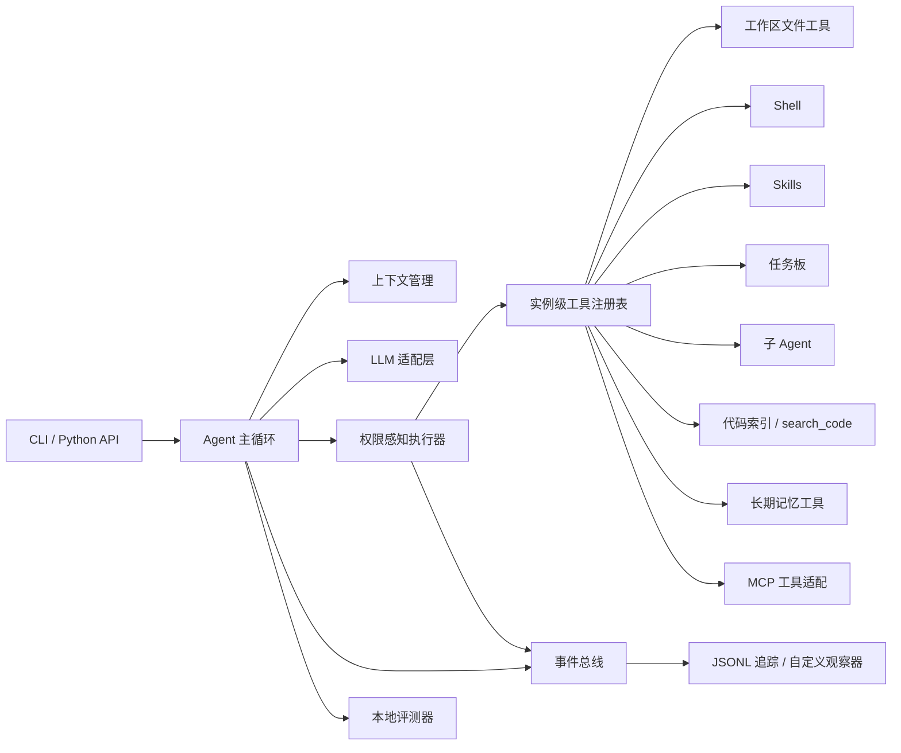

<p align="center">
  
</p>

<h1 align="center">CastorCoder</h1>

<p align="center">
  <em>一个可观测、工作区安全、仍然读得懂的 Claude Code 风格编程 Agent。</em>
</p>

> **来源说明**：本项目是基于 [he-yufeng/CastorCoder](https://github.com/he-yufeng/CastorCoder)
> 的改进版本，由个人维护，**不是**上游官方仓库。原作者署名与 MIT License 均予以保留。
> 详见 [许可与来源](#许可与来源)。

[](https://www.python.org/)
[](LICENSE)
[](#验证与实测)
[](#验证与实测)
[](CHANGELOG.md)

[更新日志](CHANGELOG.md) · [评测数据集](evals/datasets/README.md)

---

## 目录

- [项目简介](#项目简介)
- [核心特性](#核心特性)
- [安装](#安装)
- [快速上手](#快速上手)
- [命令行参考](#命令行参考)
- [会话内命令](#会话内命令)
- [配置参考](#配置参考)
- [权限与安全模型](#权限与安全模型)
- [Skills 与项目指令](#skills-与项目指令)
- [MCP 工具生态](#mcp-工具生态)
- [代码索引与混合检索](#代码索引与混合检索)
- [长期记忆](#长期记忆)
- [开发者驾驶舱](#开发者驾驶舱)
- [确定性工作流与发布门禁](#确定性工作流与发布门禁)
- [作为 Python 库使用](#作为-python-库使用)
- [架构说明](#架构说明)
- [验证与实测](#验证与实测)
- [开发与贡献](#开发与贡献)
- [常见问题](#常见问题)
- [已知边界](#已知边界)
- [许可与来源](#许可与来源)

---

## 项目简介

CastorCoder 是一个运行在终端里的 AI 编程 Agent。它保留 Claude Code 最核心的反馈循环：

```text
用户输入 → 模型推理 → 工具调用 → 本地执行 → 结果回填 → 继续推理 → 最终回答
```

在这个主循环之外，CastorCoder 补齐了真实仓库里绕不开的工程能力：工作区安全边界、实例级工具注册、权限策略、并发调度、上下文压缩、代码索引、长期记忆、会话持久化、结构化追踪、成本与轮次保护、本地可复现评测，以及发布门禁。

它既是可以直接使用的编程助手，也是一个结构清晰、可审计、可扩展的 Agent 系统实现：

- **想直接用它干活**：安装后配置模型即可在任意仓库中对话、读代码、改文件、跑测试。
- **想研究 Agent 工程**：每个关注点都有独立模块和对应测试，便于逐层阅读。
- **想二次开发**：工具、模型、策略、检索后端、MCP Server 都有明确扩展点。

项目要求 **Python 3.10–3.13**，支持 Windows、macOS 和 Linux。

---

## 核心特性

### 安全与权限

- **工作区边界**：所有内置文件工具都从固定根目录解析路径，默认拒绝 `..`、绝对路径与符号链接逃逸。
- **三档权限策略**：`plan`、`workspace`、`full_access` 在 Python 工具代码执行前统一判定；`full_access` 必须显式开启。
- **可交互审批**：`--approve` 会在被策略拦截的工具调用前询问，非交互环境自动拒绝，不会挂起。
- **参数化 Git 工具**：`shell=False` 构造 argv，只暴露 `status`、`diff`、`log`、`branch`、`show`、`blame` 等只读子命令；库中通过 `Agent(enable_git=True)` 开启。
- **网页访问防护**：`web_fetch` 拒绝非 http(s) 协议、内嵌凭据，以及解析到回环、私有、链路本地和保留地址的主机（SSRF 防护）。
- **输出脱敏**：常见 API Key、Token、密码模式在工具输出与配置展示中统一打码；`/config` 只显示 Key 是否已配置。

### 主循环与可靠性

- **ReAct 主循环**：模型与工具交替推进，所有工具调用 ID 都会得到对应结果，包括被权限拦截或触发保护的调用。
- **依赖感知并发**：相邻只读工具并发执行；写文件、Shell、任务状态和子 Agent 委派保持顺序，避免竞态。
- **死循环防护**：相同批次重复、同一调用重复、交替重放、连续工具失败都会以明确原因停止。
- **轮次上限的优雅处理**：达到 `max_rounds` 时，模型会基于已有证据做一次不带工具的最终回答，而不是直接丢弃上下文。
- **空回复重试**：推理模型把输出预算花在思考上时，可能返回空正文；主循环会丢弃空消息、提示模型简短作答，并以双倍输出上限重试（最多两次），仍为空时给出可见的 `empty_response` 停止原因，而不是静默结束。
- **上下文三层压缩**：裁剪冗长工具输出、摘要旧轮次、接近上限时硬压缩；`/compact` 可随时手动触发。
- **轮间结果裁剪**：模型已经读过的旧工具结果会在后续轮次自动缩短，最新一轮保持不变。
- **只读结果缓存**：相同只读调用在发生写操作前直接复用，减少重复 I/O。
- **原子文件修改与回滚**：写入使用临时文件原子替换，变更日志支持 `/undo` 恢复本次会话改过的文件。
- **单工具超时与输出上限**：工具可选择启用超时；所有输出统一限长并脱敏。

### 模型适配

- **OpenAI 兼容接口**：默认后端，可连接 OpenAI、DeepSeek、通义、Kimi、本地 Ollama/vLLM 等兼容服务。
- **LiteLLM 可选后端**：覆盖 Anthropic、Bedrock、Vertex 等非 OpenAI 兼容接口。
- **思考强度控制**：`/effort`（不带参数时方向键选择）与 `--effort` 支持 `auto/off/low/medium/high/max`；适配层会转换为 `reasoning_effort` 或 Anthropic 的 `thinking.budget_tokens`。
- **优雅降级**：供应商拒绝思考参数或 `stream_options` 时自动去掉该字段重试一次，并在 `/effort` 中解释原因。
- **用量回执**：每轮记录 Token、估算费用、轮次、工具数与耗时，并追加到本地用量账本。

### 检索与记忆

- **代码索引**：Python 用 AST 分块，Markdown 按标题分块，其他文本滑动窗口；SQLite FTS5 + 向量检索，RRF 融合排序，支持增量更新。
- **精确引用**：`search_code` 返回 `path:line` 与符号名，而不是整文件倾倒。
- **可切换嵌入器**：默认离线哈希向量，也支持 `openai:text-embedding-3-small` 等语义向量。
- **长期记忆**：按工作区隔离，支持 episode/decision/convention/preference/error/fact 六类记忆、内容去重、置信度、TTL、遗忘、替代关系与来源溯源。
- **记忆门控**：可选的检索预算门、分类槽位门与反模式过滤，防止把临时噪音写进长期记忆。
- **Markdown 镜像**：记忆可双向导出到人类可读的 `.castorcoder/MEMORY.md`。

### 工作流与质量

- **确定性 Graph 引擎**：非递归波次执行、DAG 循环上限、状态冲突检测，驱动 `CodeFixWorkflow` 与 `CodeReviewWorkflow`。
- **AutoRunner**：自动发现并运行 `pytest`、`unittest` 或项目测试入口，把退出码与日志反馈给 Agent，形成自纠闭环。
- **轮次审计**：`TurnAuditor` 检查工具调用成对性、未处理异常、路径越界与 Python 语法。
- **发布门禁**：`castorcoder gate` 依次运行单元测试与离线回归套件，输出结构化结论并写入 `.castorcoder/gate_report.json`。

### 可观测性

- **结构化事件**：模型轮次、工具调用、压缩、裁剪、记忆召回/写入、失败与停止原因统一产生事件。
- **JSONL 追踪**：默认写入 `.castorcoder/traces/`，可用 `--no-trace` 关闭。
- **实时状态行**：显示阶段、耗时与 Token；每次工具调用输出一条对齐的紧凑回执。
- **本地驾驶舱**：零第三方 Web 依赖的中文控制台，提供 Trace 瀑布流、Token 图表、记忆浏览、会话列表与门禁状态。

### 交互体验

- **Markdown 流式渲染**：标题、列表、代码围栏和表格按块渲染，而不是把 `##` 和反引号原样打到终端。
- **推理展示分级**：`brief` 先展示一小段再隐藏，`full` 完整流式展示，`off` 不展示。
- **会话自动保存**：每轮结束自动保存；`castorcoder -c` 续聊本工作区最近会话，`/new` 新建，`/sessions` 列表，`/resume` 方向键选择器。
- **终端编码兼容**：检测到 GBK/cp936 控制台无法编码绘制字符时，自动切换为 UTF-8 输出。

### 工程化

- **分层配置**：默认值 < 全局 TOML < 项目 TOML < 环境变量 < 命令行参数。
- **完整 CLI**：doctor、单次任务、交互模式、会话恢复、Dashboard、门禁、Graph 子命令。
- **自动化验证**：282 项测试、82% 分支覆盖率；CI 覆盖 3 个操作系统 × 4 个 Python 版本。
- **本地评测**：脚本化轨迹、35 条查询的检索消融与 k 扫描、记忆召回、真实模型任务，以及固定校验和的 HumanEval / MBPP 适配器。

---

## 安装

### 环境要求

| 项目 | 要求 |
|---|---|
| Python | 3.10、3.11、3.12、3.13 |
| 操作系统 | Windows、macOS、Linux |
| 网络 | 使用云端模型时需要；本地模型与离线评测不需要 |
| 可选依赖 | `litellm`（非 OpenAI 兼容供应商）、`pytest` / `ruff`（开发） |

### 推荐安装方式

使用 `pipx` 或 `uv tool` 安装到隔离环境，之后可在任意目录运行：

```bash
pipx install .
# 或
uv tool install .
```

安装后会同时提供 `castorcoder` 与简写 `castor` 两个命令，后者便于旧脚本迁移。

也可以使用普通虚拟环境：

```bash
python -m venv .venv
source .venv/bin/activate          # Windows: .venv\Scripts\activate
python -m pip install -e ".[dev]"
```

> 在 Windows 上，如果不想每次激活虚拟环境，可以把 `.venv\Scripts` 加入 `PATH`，
> 或把 `castorcoder.cmd` 启动器放进一个已在 `PATH` 中的目录。

### 验证安装

```bash
castorcoder --version
castorcoder --doctor
```

`--doctor` 不会调用模型，只检查版本、工作区、供应商与模型、API Key 是否配置、权限模式、工具数量、Skills、索引、记忆、思考强度等设置。

### 配置模型

CastorCoder 默认使用 OpenAI 兼容接口。至少需要提供 API Key：

```bash
export OPENAI_API_KEY=sk-...
castorcoder --doctor
```

连接任意 OpenAI 兼容服务：

```bash
export CASTORCODER_API_KEY=your-key
export CASTORCODER_BASE_URL=https://your-gateway.example.com/v1
export CASTORCODER_MODEL=deepseek-flash
castorcoder
```

连接本地模型（Ollama 示例）：

```bash
export CASTORCODER_API_KEY=local
export CASTORCODER_BASE_URL=http://localhost:11434/v1
export CASTORCODER_MODEL=qwen3:32b
castorcoder
```

使用 LiteLLM 连接 Anthropic、Bedrock、Vertex 等：

```bash
python -m pip install -e ".[litellm]"
export CASTORCODER_PROVIDER=litellm
export CASTORCODER_MODEL=anthropic/claude-sonnet-4
castorcoder
```

以上设置也可以写进 `~/.castorcoder/config.toml`，见 [配置参考](#配置参考)。

### API Key 安全

- API Key 只从环境变量或本地配置文件读取，不会写入追踪、会话、报告或文档。
- `/config` 与 `--doctor` 只显示 Key 是否已配置，不打印明文。
- MCP Server 的环境变量在配置展示中同样会被整体打码。
- 代码与测试中不包含任何真实密钥；提交前请确认 `.env` 未被纳入版本控制。

---

## 快速上手

### 交互模式

```bash
cd /path/to/your/repo
castorcoder
```

启动后先显示 CastorCoder 的 ASCII 图标，以及当前模型、工作区、会话、权限策略、思考强度、轮次上限与追踪路径。输入行带有独立边框：提交后边框会保留在回滚区，下一轮再出现新的输入框，因此不同轮次之间始终有清晰的视觉分隔。直接输入任务即可，例如：

```text
阅读这个仓库的入口文件，说明请求从接收到返回经过哪些模块
```

输入 `/help` 查看全部会话内命令，输入 `quit` 或按 `Ctrl+D` 退出。

### 单次任务

```bash
castorcoder -p "运行测试，定位失败用例的根因并修复，最后再跑一次相关测试"
```

默认会在 `.castorcoder/traces/` 写入一条结构化追踪。临时提问可以关闭：

```bash
castorcoder --no-trace -p "解释 executor.py 里并发分组的规则"
```

### 继续与恢复会话

```bash
castorcoder -c              # 继续本工作区最近一次会话
castorcoder -r              # 方向键选择历史会话
castorcoder -r 20261112_153000_ab12   # 直接恢复指定会话
```

会话会在每轮结束后自动保存。恢复时会带回历史消息、模型和任务板，并回显最近几轮对话。不同工作区的会话互相隔离，`castorcoder -c` 不会串到别的项目。

### 选择思考强度

会话内：

```text
/effort          # 打开方向键选择器
/effort high     # 立即切换
/effort auto     # 恢复供应商默认
```

启动时：

```bash
castorcoder --effort high -p "排查这个并发竞争问题"
```

可选级别为 `auto`、`off`、`low`、`medium`、`high`、`max`，也接受 `none→off`、`minimal→low`、`xhigh→high`、`ultra→max` 等别名。默认 `auto` 表示不发送任何思考参数，保持供应商原有行为。

### 权限模式

```bash
castorcoder --permission-mode plan        # 只读分析，禁止修改与 Shell
castorcoder --permission-mode workspace   # 默认：只允许工作区内修改与安全命令
castorcoder --permission-mode full_access # 显式放开工作区边界
```

需要逐次确认时加 `--approve`；非交互运行中，被拦截的调用会直接拒绝并作为工具结果返回给模型。

### 代码检索

```bash
castorcoder --rebuild-index -p "定位工作区路径校验的实现位置"
```

会话内也可以直接检索：

```text
/index                 # 增量更新索引
/index --force         # 全量重建
/search 权限校验逻辑     # 混合检索，返回 path:line
```

### 长期记忆

```text
/memory stats
/memory search 发布流程
/memory forget <id>
/memory gc
```

运行前会自动召回相关记忆并作为“检索到的数据”注入，运行后可自动沉淀；记忆按工作区隔离，不会跨项目污染。

### 开发者驾驶舱

```bash
castorcoder dashboard --port 7777 --open
```

或在会话内：

```text
/dashboard
```

驾驶舱默认只监听 `127.0.0.1`，提供 Trace 瀑布流、Token 用量、记忆库、会话列表和发布门禁状态。

### 一个完整示例

```bash
# 1. 只读定位问题
castorcoder --permission-mode plan -p "运行 pytest，总结失败原因，不要修改文件"

# 2. 允许工作区内修改，提高思考强度
castorcoder --effort high -p "修复上述失败，补充回归测试，并确保测试全绿"

# 3. 查看本次运行轨迹与消耗
castorcoder dashboard --open

# 4. 提交前跑发布门禁
castorcoder gate
```

---

## 命令行参考

```text
castorcoder [选项] [子命令]
```

### 主命令选项

| 选项 | 说明 |
|---|---|
| `-m, --model NAME` | 指定模型名称，覆盖配置 |
| `--base-url URL` | OpenAI 兼容接口地址 |
| `--api-key KEY` | 显式传入 Key；更推荐使用环境变量 |
| `-p, --prompt TEXT` | 单次任务模式；省略则进入交互模式 |
| `-r, --resume [ID]` | 恢复会话；不带值打开方向键选择器 |
| `-c, --continue` | 继续本工作区最近一次会话 |
| `-w, --workspace PATH` | 指定工作区根目录，默认当前目录 |
| `--reasoning MODE` | 推理展示量：`brief`、`full`、`off`，默认 `brief` |
| `--reasoning-chars N` | `brief` 模式先展示的字符数，默认 220 |
| `--effort LEVEL` | 思考强度：`auto`、`off`、`low`、`medium`、`high`、`max` |
| `--permission-mode MODE` | 权限策略：`plan`、`workspace`、`full_access` |
| `--max-rounds N` | 每轮最大模型/工具轮次，默认 200，最高 2000 |
| `--max-cost N` | 估算费用上限（美元），超出前停止 |
| `--no-web` | 禁用 `web_search` 与 `web_fetch` |
| `--no-ask` | 禁用 `ask_user` 工具 |
| `--no-trim` | 不裁剪旧工具结果 |
| `--no-save` | 关闭每轮自动保存 |
| `--no-status` | 关闭实时状态行 |
| `--no-index` | 禁用代码索引与 `search_code` |
| `--no-memory` | 禁用长期记忆 |
| `--rebuild-index` | 启动时全量重建索引 |
| `--no-trace` | 不写 JSONL 追踪（默认写入） |
| `--trace` | 显式开启追踪 |
| `--mcp` | 连接配置中的 MCP Server |
| `--approve` | 被策略拦截时交互式询问 |
| `--config PATH` | 指定配置文件 |
| `--doctor` | 只检查配置，不调用模型 |
| `-v, --version` | 显示版本 |

### 子命令

| 子命令 | 说明 |
|---|---|
| `castorcoder dashboard [--port 7777] [--host 127.0.0.1] [-w PATH] [--open]` | 启动本地开发者驾驶舱 |
| `castorcoder gate [-w PATH] [--report PATH] [--skip-tier2]` | 运行发布门禁：单元测试 + 离线回归套件 |
| `castorcoder graph fix -p "..." [-w PATH] [-m MODEL]` | 运行确定性的修复工作流 |
| `castorcoder graph review -p "..."` | 运行确定性代码审查工作流 |

`castorcoder-eval` 是独立评测入口：

```bash
castorcoder-eval --suite evals/suites/offline.toml --verbose
castorcoder-eval --suite evals/suites/retrieval_repo.toml --verbose
```

### 退出码

| 退出码 | 含义 |
|---|---|
| `0` | 成功 |
| `1` | 缺少 API Key、门禁未通过、会话恢复失败等可预期错误 |
| `2` | 配置错误、Agent 初始化失败或 MCP 启动失败 |

---

## 会话内命令

| 命令 | 作用 |
|---|---|
| `/status` | 运行环境、任务、会话、变更文件、索引/记忆状态与上一轮指标 |
| `/session` | 当前会话 ID、轮数与上一轮用量回执 |
| `/new` | 保存当前对话并开启新会话 |
| `/tools` | 工具列表及风险分类 |
| `/skills` | 已发现的 Skill 元数据 |
| `/tasks` | 当前任务板 |
| `/model [name]` | 查看或切换模型 |
| `/effort [level]` | 选择思考强度：`auto`、`off`、`low`、`medium`、`high`、`max` |
| `/reasoning [brief / full / off]` | 控制推理过程展示量 |
| `/rounds [N]` | 查看或修改每轮工具调用上限（默认 200，最高 2000） |
| `/tokens` | 上一轮 Token 用量与费用估算 |
| `/cost` | 本轮与持久化用量账本的汇总 |
| `/compact [N]` | 立即压缩上下文，保留最近 N 条消息 |
| `/diff` | 当前 Agent 实例改动的文件 |
| `/undo` | 恢复本次会话修改过的文件 |
| `/index [--force]` | 构建或更新代码索引，`--force` 全量重建 |
| `/search <query>` | 对代码库做混合检索 |
| `/memory list / search / stats / forget / gc` | 长期记忆管理 |
| `/save [name]` | 原子保存会话，可指定自定义 ID |
| `/sessions [--all]` | 列出本工作区会话，`--all` 查看所有工作区 |
| `/resume [id]` | 打开会话选择器，或按编号/ID 直接恢复 |
| `/dashboard [port]` | 在后台线程启动本地驾驶舱 |
| `/trace` | 显示当前 JSONL 追踪路径 |
| `/config` | 显示脱敏后的有效配置 |
| `/reset` | 重置对话、任务与变更日志 |
| `/help` | 显示命令帮助 |
| `quit` / `exit` | 退出 |

输入支持中文全角斜杠 `／`，命令名大小写不敏感，参数保持原样。

---

## 配置参考

### 优先级

```text
默认值
  < ~/.castorcoder/config.toml        全局配置
  < <工作区>/.castorcoder/config.toml  项目配置
  < 环境变量
  < 命令行参数
```

`~/.castorcoder/config.toml` 在任意目录都会被读取，适合放模型、API Key、Base URL 等全局设置。项目配置默认覆盖全局配置。

如果希望全机器只维护**一份**配置，在全局配置中写：

```toml
use_project_config = false
```

之后无论从哪个仓库启动，都只读取 `~/.castorcoder/config.toml`，不再读取项目级配置，也不会自动加载项目目录的 `.env`。临时关闭可设置 `CASTORCODER_USE_PROJECT_CONFIG=0`。shell 中显式导出的环境变量仍然优先。

### 示例配置

```toml
[castorcoder]
model = "gpt-4o"
provider = "openai"                 # openai | litellm
permission_mode = "workspace"       # plan | workspace | full_access
use_project_config = true

# 模型与请求
max_tokens = 4096
temperature = 0.0
max_context_tokens = 128000
request_timeout = 300

# 循环与保护
max_rounds = 200
max_parallel_tools = 8
max_tool_output = 15000
max_cost_usd = 2.0
max_consecutive_failures = 6

# 交互与展示
reasoning_mode = "brief"            # brief | full | off
reasoning_chars = 220
reasoning_effort = "auto"           # auto | off | low | medium | high | max
trace = true
auto_save = true
trim_tool_outputs = true
trim_long_chars = 4000

# 工具
web_tools = true
ask_user = true

# 代码索引
index = true
auto_index = true
embedding_model = "hash"            # hash | hash:512 | openai:text-embedding-3-small

# 长期记忆
memory = true
auto_remember = true
memory_gate = false

[mcp.servers.filesystem]            # 仅在使用 --mcp 时启动
command = "npx"
args = ["-y", "@modelcontextprotocol/server-filesystem", "."]
risk = "read"
```

### 配置项与环境变量

| 配置项 | 环境变量 | 默认值 | 说明 |
|---|---|---|---|
| `model` | `CASTORCODER_MODEL` | `gpt-4o` | 模型名称 |
| `api_key` | `CASTORCODER_API_KEY`、`OPENAI_API_KEY`、`DEEPSEEK_API_KEY` | 空 | API Key |
| `base_url` | `CASTORCODER_BASE_URL`、`OPENAI_BASE_URL` | 空 | 接口地址 |
| `provider` | `CASTORCODER_PROVIDER` | `openai` | `openai` 或 `litellm` |
| `max_tokens` | `CASTORCODER_MAX_TOKENS` | `4096` | 单次回答上限 |
| `temperature` | `CASTORCODER_TEMPERATURE` | `0.0` | 采样温度 |
| `max_context_tokens` | `CASTORCODER_MAX_CONTEXT` | `128000` | 上下文预算 |
| `max_rounds` | `CASTORCODER_MAX_ROUNDS` | `200` | 每轮最大轮次，最高 2000 |
| `max_tool_output` | `CASTORCODER_MAX_TOOL_OUTPUT` | `15000` | 单工具输出上限 |
| `max_parallel_tools` | `CASTORCODER_MAX_PARALLEL` | `8` | 并发只读工具上限 |
| `permission_mode` | `CASTORCODER_PERMISSION_MODE` | `workspace` | 权限策略 |
| `max_cost_usd` | `CASTORCODER_MAX_COST_USD` | 空 | 费用上限 |
| `trace` | `CASTORCODER_TRACE` | `true` | 是否写 JSONL 追踪 |
| `reasoning_mode` | `CASTORCODER_REASONING` | `brief` | 推理展示量 |
| `reasoning_chars` | `CASTORCODER_REASONING_CHARS` | `220` | `brief` 展示字符数 |
| `reasoning_effort` | `CASTORCODER_REASONING_EFFORT` | `auto` | 思考强度 |
| `auto_save` | `CASTORCODER_AUTO_SAVE` | `true` | 每轮自动保存 |
| `trim_tool_outputs` | `CASTORCODER_TRIM_TOOL_OUTPUTS` | `true` | 轮间裁剪旧结果 |
| `trim_long_chars` | `CASTORCODER_TRIM_LONG_CHARS` | `4000` | 触发裁剪的长度 |
| `max_consecutive_failures` | `CASTORCODER_MAX_CONSECUTIVE_FAILURES` | `6` | 连续失败停止阈值 |
| `web_tools` | `CASTORCODER_WEB_TOOLS` | `true` | 启用网页工具 |
| `ask_user` | `CASTORCODER_ASK_USER` | `true` | 启用交互提问 |
| `request_timeout` | `CASTORCODER_REQUEST_TIMEOUT` | `300` | 单次请求超时（秒） |
| `workspace` | `CASTORCODER_WORKSPACE` | `.` | 工作区根目录 |
| `allow_outside_workspace` | `CASTORCODER_ALLOW_OUTSIDE_WORKSPACE` | `false` | 允许越界访问 |
| `use_project_config` | `CASTORCODER_USE_PROJECT_CONFIG` | `true` | 是否读取项目配置 |
| `index` | `CASTORCODER_INDEX` | `true` | 启用代码索引 |
| `auto_index` | `CASTORCODER_AUTO_INDEX` | `true` | 检索时自动建索引 |
| `embedding_model` | `CASTORCODER_EMBEDDING_MODEL` | `hash` | 嵌入后端 |
| `index_path` | `CASTORCODER_INDEX_PATH` | 工作区内 | 索引数据库路径 |
| `memory` | `CASTORCODER_MEMORY` | `true` | 启用长期记忆 |
| `auto_remember` | `CASTORCODER_AUTO_REMEMBER` | `true` | 运行后自动沉淀 |
| `memory_gate` | 无 | `false` | 启用记忆门控 |
| `memory_path` | `CASTORCODER_MEMORY_PATH` | 工作区内 | 记忆数据库路径 |
| `mcp_servers` | 仅 TOML | 空 | MCP Server 配置 |

### 其他环境变量

| 变量 | 作用 |
|---|---|
| `CASTORCODER_HOME` | 覆盖 `~/.castorcoder` 目录位置 |
| `CASTORCODER_USAGE_LOG` | 覆盖用量账本 `usage.jsonl` 路径 |
| `CASTORCODER_NO_STATUS` | 非空时关闭实时状态行 |
| `CASTORCODER_SEARCH_API_KEY` | `web_search` 使用的 Tavily Key |
| `TAVILY_API_KEY` | 同上，兼容 Tavily 官方变量名 |
| `CASTORCODER_EVAL_LIVE` | 设为 `1` 时允许评测运行真实模型任务 |

配置值会在启动时校验；非法值会直接给出可读错误，而不是在运行中途失败。

---

## 权限与安全模型

| 模式 | 读取/搜索/Skills | 修改文件 | Shell | 子 Agent |
|---|---:|---:|---:|---:|
| `plan` | 允许 | 拦截 | 拦截 | 拦截 |
| `workspace`（默认） | 允许 | 仅工作区内 | 工作区内安全命令 | 允许 |
| `full_access` | 允许 | 可越过工作区 | 仍保留高危命令检测 | 允许 |

`full_access` 必须显式开启。即使在该模式下，Shell 工具仍会拦截明显的磁盘破坏、fork bomb、下载后直接执行等命令。

安全设计要点：

- **路径解析**：相对路径从稳定根目录解析，不依赖进程当前目录；解析符号链接后再做包含性检查。
- **调用前判定**：权限在工具 Python 代码执行前应用，避免副作用已经发生才拦截。
- **参数校验**：必需参数、未知参数和类型在进入工具前统一检查。
- **输出边界**：中央统一限长与脱敏，避免模型被超长输出或敏感信息淹没。
- **异常隔离**：事件观察器抛异常不会中断主循环。
- **审批不挂起**：非交互环境下，被拦截的调用直接拒绝并把原因返回给模型。

需要强调的是：**工作区是策略边界，不是操作系统级沙箱**。Shell 子进程仍然拥有当前用户的系统权限。需要强隔离时，应把 CastorCoder 放进容器、虚拟机或受限服务账号中运行。

---

## Skills 与项目指令

Skills 按以下顺序发现，项目级定义优先于用户级定义：

1. `<工作区>/.castorcoder/skills/*/SKILL.md`
2. `<工作区>/.claude/skills/*/SKILL.md`
3. `~/.castorcoder/skills/*/SKILL.md`

系统提示词只加入名称与描述，模型需要时再通过 `load_skill` 工具加载完整正文。这是渐进式披露，而不是把所有内容一次性拼进上下文。

一个 Skill 的格式：

```markdown
---
name: secure-review
description: 审查信任边界与敏感数据流。
---

# 工作流

1. 列出所有不可信输入。
2. 追踪校验与授权路径。
3. 用文件位置给出证据。
```

仓库级约束会从以下文件读取：

- `AGENTS.md`
- `CLAUDE.md`
- `.castorcoder/instructions.md`

本项目自带的 [code-review Skill](.castorcoder/skills/code-review/SKILL.md) 可直接作为模板。

---

## MCP 工具生态

CastorCoder 内置一个无第三方依赖的 stdio MCP 客户端，支持 `initialize`、`tools/list` 与 `tools/call`，会把外部工具的 `inputSchema` 适配成本地 Tool 协议。

配置：

```toml
[mcp.servers.filesystem]
command = "npx"
args = ["-y", "@modelcontextprotocol/server-filesystem", "."]
risk = "read"          # read | write | shell，决定权限策略
cwd = "."              # 可选
env = { NODE_ENV = "production" }  # 可选，展示时整体打码
```

启动时加 `--mcp` 才会连接：

```bash
castorcoder --mcp
```

MCP 工具默认 `parallel_safe=False`，风险等级由配置决定。客户端覆盖常见工具调用工作流，不包含全部可选协议能力。

---

## 代码索引与混合检索

索引数据库位于 `.castorcoder/index.db`：

- Python 文件用 `ast` 分块，每块保留符号名与 `path:start-end` 范围。
- Markdown 按标题分块，其他文本使用滑动行窗口。
- 文件按内容哈希增量更新，未变化文件跳过，删除文件同步清理。
- 词法检索使用 SQLite FTS5/BM25，向量检索使用配置的嵌入器，`rrf_fuse` 融合两路排名，无需分数校准。
- 默认 `HashingEmbedder` 确定性、离线、零额外依赖；`openai:<model>` 可切换为语义向量。

`search_code` 是只读、可并发工具，返回引用而不是整文件内容：

```text
src/workspace.py:42-67  resolve_path  (symbol)
```

常用操作：

```bash
castorcoder --rebuild-index -p "找到权限判定的入口"
castorcoder -p "搜索 executor 里并发分组的实现"
```

```text
/index
/index --force
/search 记忆召回
```

嵌入器切换时，向量按模型名分区存储，不会把不兼容的向量空间混在一起。

---

## 长期记忆

`MemoryStore` 是按工作区隔离的 SQLite 数据库，支持六类记忆：

| 类型 | 用途 |
|---|---|
| `episode` | 一次任务发生了什么 |
| `decision` | 明确的技术决策与根因 |
| `convention` | 项目约定与风格 |
| `preference` | 用户偏好与指令 |
| `error` | 可复用的错误与修复经验 |
| `fact` | 稳定事实 |

能力包括：内容哈希去重、置信度、TTL、`superseded_by` 替代关系、来源溯源、BM25 + 向量检索（同样使用 RRF 融合）、`forget` / `gc` / `list` / `stats`。

运行前会把相关记忆以“检索到的数据”注入系统提示词，并限制 Token 预算；运行后 `MemoryWriter` 会把变更文件、工具错误、用户指令和根因陈述分别沉淀为对应类型。注入内容不会被当作指令执行。

可选的记忆门控（`memory_gate = true`）包括：

- **检索门**：按 Token 预算限制注入量。
- **槽位门**：按类目限制容量，例如 10 条约定、15 条决策、20 条事实，超出时淘汰最久未用项。
- **反模式过滤**：拒绝“我接下来要运行 pytest”“让我看看第 10 行”这类临时噪音。

记忆可镜像到 `.castorcoder/MEMORY.md`，方便人工阅读与版本管理。

---

## 开发者驾驶舱

驾驶舱完全基于 Python 标准库 `http.server`，不引入额外 Web 框架；界面为中文，默认只监听本机。

```bash
castorcoder dashboard --port 7777 --open
```

会话内启动：

```text
/dashboard
/dashboard 7788
```

功能：

- **追踪瀑布流**：每次运行的事件时间线、轮次/工具耗时、Token 总量、失败数与停止原因；原始事件载荷折叠展示。
- **追踪列表**：开始时间、总耗时、事件数、Token、工具调用/失败数、停止原因。
- **Token 用量**：按运行统计的条形图与最近运行账本。
- **记忆库**：按类目和关键词过滤，查看置信度、来源与时间。
- **会话列表**：当前工作区的历史会话。
- **发布门禁**：最近一次门禁结论与分层结果。
- **深链**：支持 `#traces`、`#memory`、`#usage`、`?trace=<run>`，可以把一次调查直接分享成链接。

JSON 接口：

| 路径 | 内容 |
|---|---|
| `/api/status` | 工作区、模型、会话、追踪与账本摘要 |
| `/api/traces` | 追踪列表 |
| `/api/traces/<run>` | 单次运行的完整事件 |
| `/api/memories` | 记忆列表 |
| `/api/sessions` | 会话列表 |
| `/api/usage` | 用量账本聚合 |
| `/api/gate` | 最近一次门禁报告 |

---

## 确定性工作流与发布门禁

### Graph 工作流

`castorcoder.graph` 提供非递归的波次执行引擎：

- 节点按 DAG 层级推进，同层节点可并发。
- 状态写入冲突会抛出 `GraphStateCollision`。
- 超过最大访问次数会抛出 `GraphCycleLimit`，防止失控循环。
- 内置修复与审查两条工作流：

```bash
castorcoder graph fix -p "修复 tests/test_executor.py 的失败用例"
castorcoder graph review -p "审查当前工作区的未提交改动"
```

修复工作流按 `分诊 → 检索 → 实现 → 自动验证 → 审查` 推进；验证失败会带着错误日志回到实现节点重试，默认最多 3 次。审查工作流检查变更文件与 Python 语法并输出结论。

### 发布门禁

```bash
castorcoder gate
```

依次执行：

| 层级 | 内容 | 失败后果 |
|---|---|---|
| Tier 1 | 全量单元测试 | 门禁关闭 |
| Tier 2 | 离线回归评测套件（8 个任务） | 门禁关闭 |

结果写入 `.castorcoder/gate_report.json`，退出码为 0（可发布）或 1（阻止发布）。仅想跑单元测试时可以加 `--skip-tier2`。

### 轮次审计

`TurnAuditor` 在评测与调试中检查：

- 每个工具调用是否有配对的工具结果。
- 是否出现未处理异常。
- 工具访问路径是否落在工作区内。
- 生成的 Python 文件是否语法合法。

---

## 作为 Python 库使用

### 基础 Agent

```python
from castorcoder import Agent, CodeIndex, LLM, MemoryStore, Workspace

workspace = Workspace("./my-project")
llm = LLM(
    model="gpt-4o",
    api_key="your-key",
    temperature=0,
    reasoning_effort="high",
)
index = CodeIndex(workspace)
memory = MemoryStore(
    workspace.root / ".castorcoder" / "memory.db",
    workspace=str(workspace.root),
)

agent = Agent(
    llm=llm,
    workspace=workspace,
    permission_mode="workspace",
    trace_path="./my-project/.castorcoder/traces/demo.jsonl",
    code_index=index,
    memory_store=memory,
    auto_remember=True,
)

result = agent.run("定位根因、实现修复并运行相关测试")
print(result.output)
print(result.stats)
```

### 自定义工具

每个 Agent 拥有自己的工具注册表，自定义工具无需修改全局列表：

```python
from castorcoder import Agent, LLM, Workspace, create_tools
from castorcoder.tools.base import Tool


class DependencyGraphTool(Tool):
    name = "dependency_graph"
    description = "返回某个模块的直接依赖。"
    parameters = {
        "type": "object",
        "properties": {"module": {"type": "string"}},
        "required": ["module"],
        "additionalProperties": False,
    }
    risk = "read"
    parallel_safe = True

    def execute(self, module: str) -> str:
        return f"{module} 的依赖：…"


workspace = Workspace(".")
agent = Agent(
    llm=LLM(model="gpt-4o", api_key="your-key"),
    workspace=workspace,
    tools=[*create_tools(workspace), DependencyGraphTool()],
)
```

### 订阅事件

```python
from castorcoder import AgentEvent, EventBus

bus = EventBus()


def observer(event: AgentEvent) -> None:
    print(event.type, event.data)


bus.subscribe(observer)
agent = Agent(llm=llm, workspace=Workspace("."), event_bus=bus)
agent.run("解释这个仓库的入口")
```

稳定事件类型：

```text
run.started          run.completed
llm.started          llm.completed
tool.started         tool.completed
context.compressed   context.trimmed
memory.gate          memory.retrieved    memory.written
autorun.completed
```

事件包含 `run_id`、时间戳、类型与可序列化数据。`tool.completed` 携带成功状态、耗时和脱敏后的输出预览；`run.completed` 携带完整 `AgentStats` 与轮次回执。

### 确定性工作流

```python
from castorcoder.graph.workflows import create_code_fix_workflow

workflow = create_code_fix_workflow(agent)
state = workflow.run({"task": "修复失败测试"})
print(state["final_report"])
```

---

## 架构说明



核心模块：

| 模块 | 职责 |
|---|---|
| `agent.py` | 主循环、停止条件、结果裁剪、只读缓存、记忆注入与沉淀 |
| `executor.py` | 参数校验、权限应用、并发分组、超时、脱敏与输出限长 |
| `tools/` | 文件、Shell、编辑、搜索、网页、Git、任务、Skills、子 Agent、记忆工具 |
| `context.py` | 三层上下文压缩 |
| `trim.py` | 轮间旧结果裁剪 |
| `llm.py` | OpenAI 兼容与 LiteLLM 适配、流式解析、可选参数降级 |
| `reasoning.py` | 中性思考级别与供应商参数翻译 |
| `workspace.py` | 工作区根目录与路径安全 |
| `session.py` | 原子会话保存、加载与旧格式迁移 |
| `memory/` | 记忆存储、检索、写入、门控与 Markdown 镜像 |
| `index/` | 分块、嵌入、SQLite FTS5/向量存储、RRF 检索 |
| `graph/` | 波次图引擎与内置工作流 |
| `autorun.py` | 测试入口发现、执行与 MANIFEST 生成 |
| `evals/` | 评测运行器、指标、轮次审计与发布门禁 |
| `dashboard/` | 标准库 HTTP 服务与中文控制台页面 |
| `mcp/` | stdio JSON-RPC 客户端与工具适配 |
| `skills.py` / `planning.py` | Skills 目录与任务板 |
| `ui.py` / `picker.py` | 终端渲染、状态行与方向键选择器 |
| `metrics.py` | 轮次回执与持久化用量账本 |
| `events.py` | 事件总线与 JSONL 追踪 |

详细的运行时序、组件不变量与扩展方式可从 `castorcoder/` 各模块的 docstring 与 `tests/` 中的用例查看。

---

## 验证与实测

### 当前工程验证（2026-11-12）

| 检查项 | 结果 |
|---|---|
| 自动化测试 | **282 passed** |
| 分支覆盖率 | **82%**（CI 门槛 80%） |
| 静态检查 | `ruff check` 通过 |
| 编译检查 | `compileall` 通过 |
| CI 矩阵 | Ubuntu / macOS / Windows × Python 3.10–3.13 |

### v1.3.0 实测（2026-11-11）

| 项目 | 结果 |
|---|---|
| 离线机制评测 | **8/8 任务通过** |
| Live 工程任务 | **7/7 通过**，平均 10.0 轮、14.6 次工具调用，总费用 $0.203，734 秒 |
| 仓库检索（300 文件 / 2,061 chunks） | 文件级 Recall@5：hybrid **74.3%**、BM25 **80.0%**、哈希向量 40.0% |
| 符号级检索 | hybrid **54.3%**、BM25 60.0%、哈希向量 20.0% |
| HumanEval 全量 164 题 | **164/164**，pass@1 **100%**（95% CI 97.7–100%），平均 1.988 轮，$0.400 |
| 真实编码冒烟 | 建文件 + pytest：4 轮 / 5 工具 / 15.3 秒 / $0.0023 |

### 历史结果（v1.1.0，2026-11-08/09）

| 项目 | 结果 |
|---|---|
| 真实模型编码任务 | `deepseek-flash` · 7 任务 × 3 次 = 21 次运行 · pass@1 **85.7%（18/21）** |
| 平均轮次 / 工具调用 | 9.8 轮 / 14.0 次 |
| 单次平均费用 | **$0.0349** |
| HumanEval | 164/164 · pass@1 100% · 2.0 轮 · $0.00253/题 |
| MBPP sanitized | 327/427 · pass@1 76.6%（95% CI 72.3–80.3%）· 43 次失败被 4,096 Token 上限截断 |
| 检索消融 | 141 文件 / 900 chunks · 文件级 Recall@5：BM25 82.9%、hybrid 80.0%、哈希向量 54.3% |

固定样例仓库用于验证 Agent 机制，不代表通用编码能力。完整套件与复现命令见 `evals/suites/`；运行评测后结果默认写入 `evals/results/`，该目录不纳入版本控制。

---

## 开发与贡献

### 本地开发

```bash
git clone https://github.com/bingyulove99-ai/castorcoder.git
cd castorcoder
python -m venv .venv
source .venv/bin/activate          # Windows: .venv\Scripts\activate
python -m pip install -e ".[dev]"
```

### 常用命令

```bash
python -m pytest -q
python -m pytest --cov=castorcoder --cov-report=term-missing
python -m ruff check castorcoder tests evals/scripts
python -m compileall -q castorcoder tests evals/scripts
castorcoder-eval --suite evals/suites/offline.toml --verbose
```

### 目录结构

```text
CastorCoder/
├── castorcoder/           # 主程序包
│   ├── agent.py           # 主循环
│   ├── executor.py        # 权限感知执行器
│   ├── tools/             # 内置工具
│   ├── index/             # 代码索引与检索
│   ├── memory/            # 长期记忆
│   ├── graph/             # 波次工作流引擎
│   ├── evals/             # 评测与发布门禁
│   ├── dashboard/         # 本地驾驶舱
│   └── mcp/               # MCP 客户端
├── tests/                 # 自动化测试
├── evals/                 # 评测套件、数据与结果
└── examples/              # 自定义工具示例
```

### 贡献流程

1. Fork 仓库并从 `main` 创建分支。
2. 保持改动聚焦，补充对应测试。
3. 运行 `pytest`、`ruff` 与 `compileall`，确保全部通过。
4. 在 `CHANGELOG.md` 的 `Unreleased` 下记录用户可见变化。
5. 提交 Pull Request，说明动机、实现与验证方式。

代码风格：行宽 100，启用 `E`、`F`、`I`、`UP`、`B`、`SIM` 规则；公开接口保持向后兼容。

---

## 常见问题

### 启动提示找不到 API Key

```text
No API key found.
Set CASTORCODER_API_KEY or OPENAI_API_KEY.
```

设置任一环境变量，或写入 `~/.castorcoder/config.toml`。连接本地兼容服务时，Key 可以填任意非空占位值，例如 `local`。

### 供应商报错 `reasoning_effort` 或 `thinking` 不支持

适配层会自动去掉该字段重试一次，不会中断对话。`/effort` 会显示：

```text
provider rejected reasoning_effort=high; using its default
```

这说明当前网关不支持该参数，模型会使用自身默认行为。

### 模型只思考、不输出，对话像“卡住后直接结束”

这是推理模型把输出预算全部花在思考上的典型情况：供应商返回 `finish_reason = length` 但没有正文，也没有工具调用。主循环现在会自动处理：

1. 丢弃这条空回复，并追加一条要求模型简短作答的提示；
2. 把本次调用的输出上限翻倍后重试（最多两次，最高 32768）；
3. 如果供应商拒绝更大的上限，回退到原配置继续重试；
4. 仍然为空时，以 `empty_response` 停止并打印处理建议，而不是静默回到输入行。

如果频繁出现，可以降低思考强度或提高上限：

```toml
# ~/.castorcoder/config.toml
max_tokens = 8192
```

```text
/effort low
```

### 中文或表格乱码

CastorCoder 会检测控制台编码。GBK/cp936 终端无法编码 Markdown 绘制字符时，会自动切换为 UTF-8；如果仍有问题，可执行：

```bash
chcp 65001
```

或把终端字体换成支持中文的等宽字体。

### 修改了配置文件但没有生效

按优先级检查是否有更高层覆盖：

1. 命令行参数；
2. shell 中已导出的环境变量；
3. 项目 `.castorcoder/config.toml`；
4. 全局 `~/.castorcoder/config.toml`。

使用 `castorcoder --doctor` 与 `/config` 查看最终生效值。若全局配置设置了 `use_project_config = false`，项目配置和项目 `.env` 都会被忽略。

### 索引没有更新

默认增量索引会跳过内容未变的文件。需要强制重建时：

```bash
castorcoder --rebuild-index -p "…"
```

会话内：

```text
/index --force
```

### `castorcoder -c` 找不到上次会话

`-c` 只恢复**当前工作区**最近的会话。确认启动目录一致，或使用：

```bash
castorcoder -r
```

查看全部历史并手动选择。

### 运行很久没有输出

- 用 `--no-status` 排除状态行渲染问题；
- 用 `--reasoning off` 关闭推理展示；
- 检查 `max_rounds` 是否过大；
- 查看 `.castorcoder/traces/` 中最新追踪，或在驾驶舱里查看事件瀑布。

### 费用超出预期

```bash
castorcoder --max-cost 1.0 -p "…"
```

`/cost` 查看本轮与账本汇总，`/tokens` 查看上一轮明细。估算基于已知模型价格，未知模型只给出近似值。

### Windows 下 Shell 启动慢

内置 Shell 工具会优先使用轻量命令路径，并跳过不必要的 PowerShell 启动。若仍然偏慢，可以把常用命令写成脚本，或使用 `git` 工具做只读检查。

---

## 已知边界

项目对这些边界有明确说明，不把它们包装成已经解决的问题：

- **Shell 不是容器级沙箱**：策略可以拦截高危命令，但子进程仍拥有当前用户权限。
- **Token 与费用是估算**：部分供应商不返回 usage，此时只能按字符数近似。
- **哈希向量不是语义模型**：默认嵌入器是离线词法基线，语义检索请配置 `openai:<model>`。
- **MCP 覆盖常见工作流**：支持 stdio 下的初始化、工具发现与调用，不包含全部可选协议能力。
- **检索评测规模有限**：样例仓库用于验证机制，不等同于大规模代码库基准。
- **Graph 工作流是确定性的工程编排**：它不会替代模型自身的推理能力。
- **驾驶舱面向本机调试**：默认只绑定 `127.0.0.1`，没有内置身份认证，不应直接暴露到公网。

后续可扩展方向包括：容器沙箱后端、流式工具执行、带 worktree 隔离的并行子 Agent、OpenTelemetry 导出，以及更大规模外部仓库评测。

---

## 许可与来源

本项目是 **[he-yufeng/CastorCoder](https://github.com/he-yufeng/CastorCoder) 的改进版本**，由个人维护，不是上游官方仓库。改进内容包括工作区安全模型、权限策略、工具系统、上下文管理、代码索引与检索、长期记忆、可观测性、本地评测框架、发布门禁等工程化能力。

原项目的精简 Python 实现与 Claude Code 架构分析文章可在上游仓库中查看；原作者署名与 MIT License 均予以保留。

本项目采用 [MIT License](LICENSE)。你可以自由使用、修改和分发，但请保留版权声明与许可文本。

评测数据集（HumanEval、sanitized MBPP）为第三方素材，分别遵循 MIT 与 CC-BY-4.0，来源、行数与 SHA-256 见 [`evals/datasets/README.md`](evals/datasets/README.md)。
